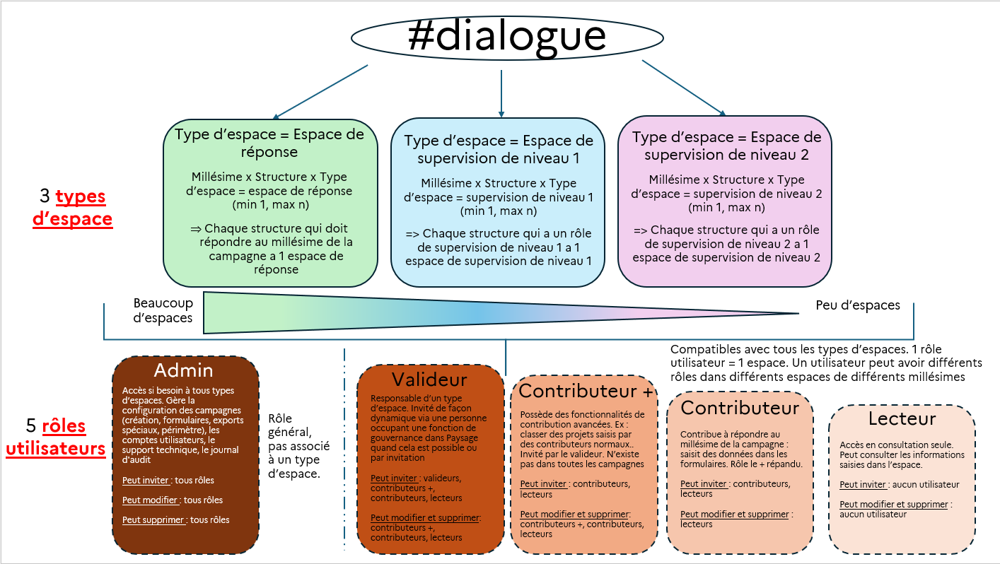

# Dialogue v2

- POC V2 in PHP https://github.com/dataesr/dialoguev2-poc -> see it live here https://dialogue.dataesr.fr/
- https://github.com/dataesr/dialoguev2-poc/blob/main/docs/PRESENTATION-EQUIPE-INTERNE.md
- https://github.com/dataesr/dialoguev2-poc/blob/main/docs/Dialogue_Interactions_Specifications.md
- POC to choose the form tool https://github.com/dataesr/dialogue-poc

## Technical stack
- npm
- DSFR+ https://github.com/dataesr/dsfr-plus
- React + TypeScript
- vite https://vite.dev/guide/#scaffolding-your-first-vite-project
- SurveyJS https://surveyjs.io/
- node ^22.18.0 || >=24
- Express https://expressjs.com/en/5x/starter/installing/

No choice is currently made between axios and fetch.

## SSO

cf. documentation https://kit.dev.dataesr.ovh/ui/app/kit-provider

## Install

`npm i`

## Run locally

`npm start`

Client: http://localhost:5173/
Server: http://localhost:3000/

## Deployment

The version number follows [semver](https://semver.org/).

To deploy in production, simply run this command from your staging branch :

`npm run deploy:[patch|minor|major]`

⚠️ Obviously, only members of the [dataesr organization](https://github.com/dataesr/) have rights to push on the repo.

## Wording

- Campagnes -> campaigns
  - Sans validation -> none
  - Validation déclarative -> declarative
  - Validation bloquante -> locking
- Millésimes -> vintages
  - Brouillon -> draft
  - En test -> test
  - Publiée -> published
  - Fermée -> closed
  - Archivée -> archived
- Espaces -> spaces
  - reponse -> Répondant
  - supervision_s -> Superviseur niveau 1
  - supervision_v -> Superviseur niveau 2
- Etablissements -> structures

## Users

cf. Dialogue v1 & POC

Espace = millésime x établissement x type d'espace

3 types d'espace
- Contribution
- Superviseur niveau 1 (souvent au niveau du rectorat, gestion de la campagne à l'échelle académique donc gère les établissements de la région académique telle que définie par Paysage)
- Superviseur niveau 2 (plutôt le ministère et les MOA des différentes campagnes, donc gère tous les établissements qui participent à la campagne)
- Admin (Yann, Alexandra & Mialy, gestion des codes d'inviation, ajout ou suppression d'utilisateurs de l'administration, gestion des droits de ces utilisateurs ...)

4 rôles associés à des espaces de type "Contribution"
- Lecteur
- Répondant
- Répondant plus (Rôle disponible uniquement dans certaines campagnes, est un contributeur avec des rôles en plus (par exemple classer des fiches-projets, elles même rédigées par les contributeurs))
- Valideur

Chaque rôle peut voir la liste des campagnes en cours, en test ou passées des espaces auxquels il est rattaché. Un utilisateur peut se créer un compte sur Dialogue, donc avec l'espace lié. Un même utilisateur peut avoir accès à plusieurs espaces de plusieurs millésimes. Dans ce cas, sa page d'accueil liste les espaces des millésimes des différentes campagnes auxquels il appartient / a accès.

Un même établissement peut exister au sein d'espaces différents dans un millésime. Avec donc des types différents.

Un code d'invitation peut être saisi dans l'UI de réponse de Dialogue.

Paysage assure le lien entre un nom de domaine d'adresse email et une structure (et donc un espace). Chaque code est lié à un millésime d'une campagne et un rôle, et en fonction du domaine de l'adresse email on est rattaché à une structure. Donc une fois le code saisi, j'arrive dans l'espace dédié et là je peux répondre à l'enquête.

Un utilisateur de Dialogue peut en inviter un autre par email, ces utilisteurs auront un rôle identique ou "inférieur" au sien. Par exemple, un superviseur peut inviter des utilisateurs avec un rôle lecteur, contributeur ou superviseur.

Pour les rôles de validateurs, le process est différent. Cf. Paysage et l'équipe de direction de la structure avec les adresses emails de la directrice / du directue rqui sont immédiatement ajoutés comme valideurs.

Sur le POC, il existe une page qui liste les différences entre les rôles de gouvernance dans Paysage et les rôles de valideurs dans Paysage (attention aux dates de validation): https://dialogue.dataesr.fr/admin/paysage/domaines. Donc soulève de potentiels problèmes.

Pour un espace donné, la première personne (hors rôle lecteur) à se connecter sur l'espace doit revalider, un par un, les utilisateurs de cet espace du millésime précédent. Cela est bloquant pour les autres personnes qui souhaitent de connecter à cet espace.

